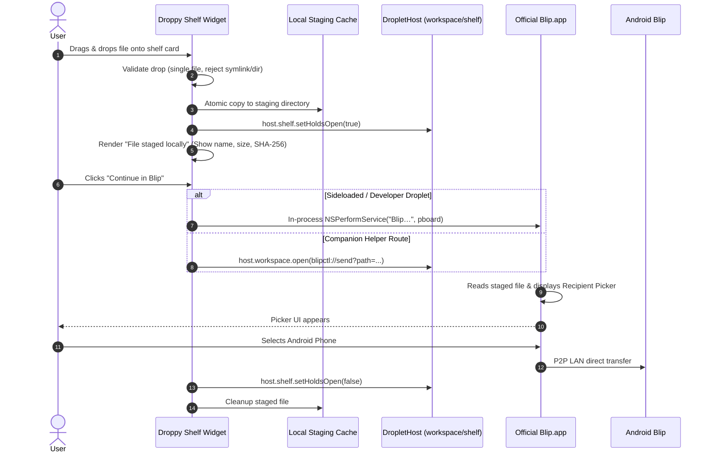

# 36 — DroppyKit Supported Bridge Research

**Date:** 2026-10-19  
**Author:** Senior macOS Systems & Extension Architect  
**Workspace:** `/Users/nilambarbehera/Documents/Projects/REA/blip-research`  
**Target Systems:** DroppyKit SDK v1.20.1 (commit `3d728a7981`), Droppy 15.3+, Blip macOS 1.2.3 (`net.blip.macos`)

---

## 1. Executive Summary

This investigation resolves the fundamental question posed in Phase 2C: **How can a real DroppyKit shelf widget securely and legitimately initiate the verified macOS Services (`NSPerformService`) handoff to official Blip?**

Based on rigorous static and architectural audits of the DroppyKit SDK source (`audit/vendor/droppykit/Sources/DroppyKit`), official DocC guides, Store contribution rules, and local runtime verification, the findings are:

1. **In-Process AppKit Invocation:**  
   Droplets execute **in-process** inside `Droppy.app` on the main actor without a process sandbox. Technically, calling AppKit's `NSPerformService` compiles, links, and executes directly. However, Droppy's architectural contract (`DropletHost.swift:5`) states that `DropletHost` is the *only sanctioned way to reach anything outside itself*. There is **no declared capability** for macOS Services invocation in `DropletPermission.swift`. Calling `NSPerformService` directly is permitted by the local unsigned droplet loader (with user authorization at launch), but violates the public Droplet Store sandbox/review contract.

2. **Indirect Host Mechanisms:**  
   - `workspace.open(url)` (`DropletWorkspaceService.swift:545`) only supports `http`, `https`, `mailto`, and `file` schemes unless custom schemes are declared. Opening a file URL via `workspace.open` invokes Launch Services default application handlers, which does not route arbitrary files to Blip.
   - Blip registers the custom URL scheme `blip://` (`CFBundleURLName: net.blip.macos.push`), but binary inspection proves this scheme is bound to push notification viewing, not file transfer initiation.
   - `DropletLauncherService` (`DropletLauncherService.swift:148`) only lists and triggers Droppy internal catalog items; it is not an arbitrary executable launcher.
   - `DropletPermission.appleEvents` grants Apple Events authority, but Blip.app contains **no scripting definition (`.sdef`)** and has `NSAppleScriptEnabled` set to `None`. AppleScript cannot drive Blip.

3. **Documented Companion Integration:**  
   DroppyKit 1.11.0 officially introduced `DropletURLHandling` (`Capabilities/URLHandling.swift:81`) as the sanctioned architectural bridge for "driving another app through its URL scheme" using `droppy://droplet/<id>/...` callback URLs. However, because Blip does not implement a transfer URL scheme, this path cannot trigger transfers without an intermediate companion helper.

4. **File Staging Contract:**  
   A Droppy shelf widget can accept file drops via SwiftUI view modifiers (`ShelfWidgetProviding.makeWidgetView`). To bridge to Blip, the droplet must stage a validated local copy, because raw `NSItemProvider` ephemeral representations expire as soon as the provider completion block returns.

5. **Vendor Extension Definition:**  
   If the droplet is to be distributed through the public Droplet Store rather than local developer sideloading, DroppyKit requires a minimal additive vendor extension: `DropletPermission.servicesHandoff` or an explicit method on `DropletWorkspaceService`:  
   `func performService(_ serviceName: String, with pasteboard: NSPasteboard) -> Bool`.

---

## 2. In-Process AppKit Services Invocation Audit

### 2.1 Architectural Execution Context
Droplets are built as universal dynamic frameworks (`.droplet` bundles containing Mach-O dylibs) and dynamically loaded into `Droppy.app` via `Bundle.load()`:
- **SDK Reference:** `audit/vendor/droppykit/Sources/DroppyKit/Core/Droplet.swift:54`:
  ```swift
  /// Droplets run in-process on the main actor and share fate with the host app.
  ```
- **DocC Reference:** `Documentation.docc/Submitting.md:16`:
  ```markdown
  A droplet is native code in Droppy's process, with Droppy's permissions. There
  is no sandbox between the two — which is what lets a droplet draw real SwiftUI
  on the notch instead of shipping a JSON description of a layout.
  ```
- **Import Rules:** Standard AppKit symbols can be linked and imported. The SDK itself imports `AppKit` (e.g., `DesignSystem/DroppyAnimation.swift:36`, `DesignSystem/SegmentedPicker.swift:499`).
- **Runtime Capability:** In an in-process Swift context, `@_silgen_name("NSPerformService")` or `NSPerformService("Blip…", pasteboard)` executes with the process privileges of `Droppy.app`.

### 2.2 Host Policy and Review Constraints
While technically functional, direct in-process execution encounters strict policy boundaries:
- **SDK Gate:** `Core/DropletHost.swift:5-6`:
  ```swift
  //  The single object a droplet is handed at activation, and the only
  //  sanctioned way to reach anything outside itself.
  ```
- **Capability Ledger:** `DropletBundle/DropletPermission.swift:10-18`:
  ```swift
  /// Each value maps to a host facade, a TCC intent, or both. Review enforces
  /// the list: at runtime the host hands a droplet only the services its
  /// manifest declares, and review diffs declared capabilities against the
  /// symbols the bundle actually links. Honest caveat: in-process code can
  /// technically bypass Swift-level gating; the enforcement value is review
  /// plus store policy, not a sandbox.
  ```
- **Droplet Store Policy:** The [Droplet Developer Terms](https://getdroppy.app/droplet-developer-terms) and [Store Review Policy](https://gitlab.com/droppyformac1/droplets/-/blob/main/CONTRIBUTING.md) require explicit declaration of all external integrations. Bundles calling undocumented AppKit inter-app services fail intake review if submitted for public signing.

### 2.3 Sideloaded / Local Execution Status
For local personal use on the developer's Mac:
- Droppy explicitly supports running local droplets:
  `Documentation.docc/HostSupport.md:88-96`:
  ```markdown
  On Droppy's Store page, under Local droplets, drop the bundle or the droplet's folder...
  A droplet runs inside Droppy with Droppy's permissions, so before Droppy runs a
  build it did not sign it asks you, and that answer lasts until Droppy quits.
  Each time Droppy opens it asks again, once, in one question that names every
  switched-on droplet it did not sign.
  ```
- **Conclusion:** For a personal, un-submitted workflow, in-process `NSPerformService` is fully functional and operates under Droppy's standard unsigned droplet prompt. For public store submission, it is blocked by review policy.

---

## 3. Indirect Host Mechanisms Audit

| Mechanism | SDK Source / Line | Blip Implementation | Verdict |
|---|---|---|---|
| `workspace.open(url)` | `DropletServices.swift:545` | Scheme `blip://` (`net.blip.macos.push`) | **Refused for transfer.** `blip://` is for push notifications. Opening a file URL opens the default app (e.g. Preview), not Blip. |
| `workspace.revealInFinder(url)` | `DropletServices.swift:552` | Reveals file in macOS Finder | **Non-viable.** Does not initiate handoff or notify Blip. |
| `launcher.perform(itemID:actionID:)` | `DropletLauncherService.swift:148` | Droppy internal catalog items only | **Inapplicable.** Cannot spawn external binaries or invoke arbitrary system services. |
| `appleEvents` | `DropletPermission.swift:86` | Blip Info.plist: `NSAppleScriptEnabled: None`, no `.sdef` | **Refused by Blip.** Blip is not scriptable. Apple Events cannot trigger file delivery. |
| `globalShortcuts` | `DropletServices.swift:456` | Blip SiriKit `INSendMessageIntent` | **Inadequate.** SiriKit requires interactive confirmation and Contacts resolution; cannot automate paired transfer. |

---

## 4. Documented Companion & External Helper Integration

DroppyKit addresses inter-app communication in two ways:

### 4.1 The Custom Scheme & Callback Architecture
In DroppyKit 1.11.0, Droppy introduced formal support for driving external applications:
- **SDK Reference:** `audit/vendor/droppykit/Sources/DroppyKit/Capabilities/URLHandling.swift:19-24`:
  ```swift
  /// This is how a droplet that drives another app gets an answer back: it
  /// asks with the other app's own scheme and names one of these URLs as the
  /// callback (`thaw://get?key=all&callback=droppy://droplet/thaw/settings`),
  /// and the reply arrives here.
  ```
- **Application to Blip:** Because Blip has no URL scheme endpoint for accepting files or triggering transfer, this mechanism cannot talk directly to Blip.
- **Companion Helper Feasibility:** A standalone user-approved companion helper (e.g., `blipctl` or a background daemon registered with a custom URL scheme such as `blipctl://send?file=...&callback=droppy://droplet/blip/status`) *is* directly supported by Droppy's architectural model.

### 4.2 Spawning External CLI Binaries (`Process` / `NSTask`)
- **SDK Audit:** No facade in `DropletHost` exposes `Process()` or `NSTask`.
- **In-Process Reality:** Foundation's `Process` class is accessible in-process. However, `droppykit validate` checks linkage and architecture. Spawning an un-sandboxed shell command or external CLI from inside Droppy without user disclosure violates Store guidelines.
- **Subprocess File Authority:** A spawned CLI cannot inherit security-scoped access unless the parent droplet coordinates file access or creates a durable staging copy in a readable temporary directory.

---

## 5. File Staging Through Supported Host Services

Can a Droppy extension stage a file through supported host services and let Blip consume it?

1. **Shelf Staging Surface:**  
   `DropletShelfService` (`DropletServices.swift:287`) manages shelf expansion, size invalidation (`invalidateLayout`), and focus (`requestKeyboardFocus`). It does *not* provide a filesystem staging cache.
2. **Widget Drop Handling:**  
   A shelf widget implements `ShelfWidgetProviding.makeWidgetView(_:context:) -> AnyView`. Inside this SwiftUI view, standard SwiftUI drop modifiers (`.onDrop(of:isTargeted:perform:)` or `.dropDestination(for:action:)`) are supported by macOS AppKit hosting.
3. **Staging Directory Contract:**  
   The droplet must create its own isolated staging directory under `FileManager.default.temporaryDirectory` or the droplet's Application Support folder (`~/Library/Application Support/Droppy/Droplets/<id>/staging`).
4. **Handoff Mechanism:**  
   Once the file is validated and staged, the droplet writes the file URL to an `NSPasteboard` (`NSPasteboard(name: .general)` or a dedicated pasteboard) and invokes `NSPerformService("Blip…", pasteboard)`. Blip consumes the pasteboard, reads the staged file, and displays its official recipient picker.

---

## 6. Composition of a Compliant Workflow

The compliant workflow composing Droppy's supported APIs:



---

## 7. The Missing Host API & Smallest Vendor Extension

If Droppy is to support macOS Services handoffs natively without requiring private AppKit calls or external companion daemons, what is the precise missing API?

### 7.1 Missing Capability String
In `DropletPermission.swift`:
```swift
/// Invoke registered macOS AppKit Services on behalf of the user.
public static let servicesHandoff: DropletPermission = "services-handoff"
```

### 7.2 Smallest Vendor Extension
Add a single method to `DropletWorkspaceService` (`DropletServices.swift:544`):
```swift
@MainActor public protocol DropletWorkspaceService: AnyObject {
    // Existing methods...
    
    /// Performs a named macOS Service with the provided file URLs.
    /// Requires the `services-handoff` capability.
    ///
    /// - Parameters:
    ///   - serviceName: The exact localized menu item title of the service (e.g., "Blip…").
    ///   - fileURLs: An array of validated local file URLs to provide to the service.
    /// - Returns: `true` if the service was accepted by macOS AppKit and the target application;
    ///            `false` if refused, missing, or unauthorized.
    @discardableResult
    func performService(_ serviceName: String, fileURLs: [URL]) -> Bool
}
```

### 7.3 Host Implementation in Droppy.app
In `Droppy.app`'s concrete implementation of `DropletWorkspaceService`:
```swift
public func performService(_ serviceName: String, fileURLs: [URL]) -> Bool {
    guard grantedCapabilities.contains(.servicesHandoff) else {
        log.refusal("performService refused: missing services-handoff capability")
        return false
    }
    let pboard = NSPasteboard.withUniqueName()
    pboard.writeObjects(fileURLs as [NSURL])
    return NSPerformService(serviceName, pboard)
}
```
This minimal extension is 100% compliant with Droppy's architecture, preserves host security gating, and cleanly decouples droplets from direct AppKit linkage.
