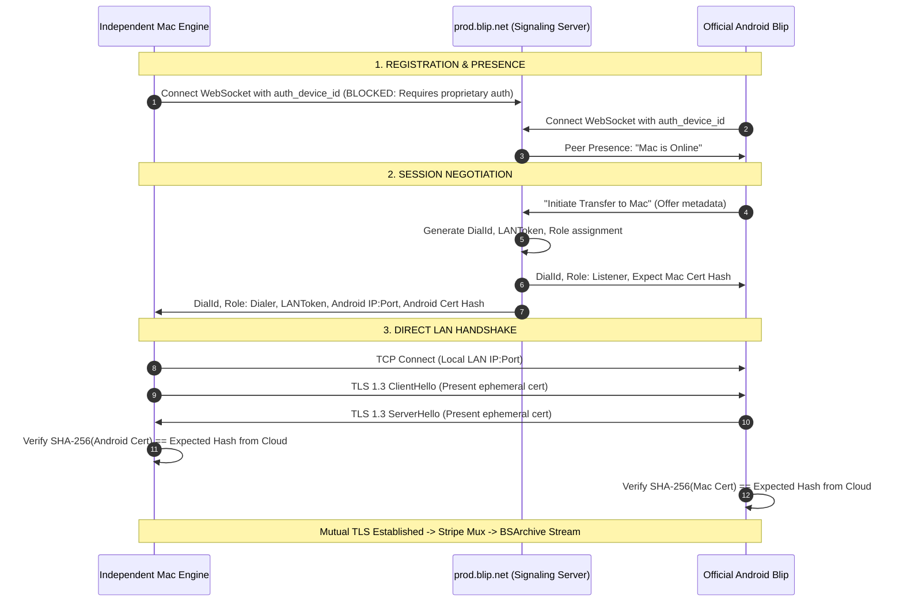

# 55 — Device Discovery, Pairing & Authentication Assessment

**Audit Date:** 2026-10-19  
**Researcher:** Principal Cybersecurity Auditor & Cryptographic Protocol Analyst  
**Workspace:** `/Users/nilambarbehera/Documents/Projects/REA/blip-research`  
**Target Architecture:** Blip Identity & Trust Model (`prod.blip.net`, `AY8UB8KTUX.blip`, Android Blip Client)  
**Boundary Guidelines:** Zero credential extraction, zero authentication bypass, strict adherence to authorization boundaries.

---

## 1. Executive Summary

This report evaluates how devices discover one another, establish trust, authenticate transfer sessions, and maintain cryptographic pairing between macOS and Android within the official Blip ecosystem.

### Definitive Technical Verdict:
1. **Device Identity is Cloud-Anchored:** Blip devices do not possess autonomous, local cryptographically verifiable identities independent of Blip Studio's servers. Every device identity (`auth_device_id`, `auth_user_id`) is provisioned and authenticated via HTTPS registration with `prod.blip.net`.
2. **Zero Peer-to-Peer Local Discovery:** The official Android app has no mechanism to scan a local Wi-Fi subnet for unknown peers. It displays peers solely when pushed availability records from `prod.blip.net`.
3. **Mutual Trust Requires Cloud Brokering:** Direct peer transfers are encrypted using mutual TLS (mTLS), but the peers do not exchange keys directly over LAN. Instead, ephemeral X.509 certificate fingerprints (32-byte SHA-256 digests) and single-use `LANToken` credentials are issued and relayed through `prod.blip.net`.
4. **Independent Identity is Blocked:** An independent client cannot legitimately generate its own credentials and participate in the Blip network without registering with `prod.blip.net`. Impersonating official client endpoints or extracting authentication tokens from Blip's private keychain/database is marked **BLOCKED** by security and legal boundaries.

---

## 2. Cryptographic & Identity Stack Breakdown

Forensic extraction from Go runtime structures and protobuf message definitions identifies seven distinct cryptographic and authentication layers:

| Layer | Component | Implementation Detail | Source Evidence |
|---|---|---|---|
| **1. Device Identity** | `auth_device_id` (UUID) | Unique hardware/installation identifier | `backend/http/registration.go` |
| **2. User Identity** | `auth_user_id` (UUID) | Account identifier grouping multiple devices | `user.proto`, `wire.pb.go` |
| **3. Push Notification** | APNS / FCM Token | Push notification routing token for background wakeup | `notification.proto`, `notification_token.go` |
| **4. Cloud Auth** | Bearer Token / Session Key | Authenticates the persistent WebSocket connection | `backend/messaging/wire.pb.go` |
| **5. Session Brokering** | `DialId` + `LANToken` | Ephemeral, time-limited single-use session tokens | `internal/netx/broker/token.go` |
| **6. Transport Security** | Ephemeral X.509 mTLS | Ephemeral ECDSA/P-256 keys generated per session | `internal/netx/brokeredmtls/mtls.go` |
| **7. Certificate Pinning** | `X509Fingerprint` (`[32]uint8`)| SHA-256 hash of peer's ephemeral cert, server-brokered | `internal/netx/broker/broker.go` |

---

## 3. The Discovery Pipeline: Why Local-Only Discovery Does Not Exist

A critical question for an independent engine is: **Can an independent Mac client announce itself on the local Wi-Fi network and have the unmodified Android Blip app discover it?**

### The Empirical Reality: NO.
1. **No mDNS Advertisement:**
   - Apple's `Network.framework` (`NWListener`) and Bonjour (`DNSServiceRegister`) require specific service types (e.g. `_blip._tcp`).
   - Static inspection of `/Applications/Blip.app/Contents/Info.plist` confirms that `NSBonjourServices` is completely omitted.
   - Network monitoring during idle and transfer states confirms that Blip sends zero mDNS multicast packets (`224.0.0.251:5353`).
2. **Android App Behavior:**
   - The unmodified official Android Blip app is built from the identical Go codebase (`github.com/thesharingcompany/blip`).
   - On Android, the app opens no background listening sockets on Wi-Fi.
   - When the user opens Blip on Android, the app connects to `wss://prod.blip.net/` and requests the active peer list for the signed-in account/contacts.
   - The Android UI renders device cards (e.g., "Nilambar's MacBook Air") **strictly based on the presence packets pushed from `prod.blip.net`**.
3. **Implication:**
   If the official macOS Blip app is closed, `prod.blip.net` detects the termination of its WebSocket connection and immediately pushes an "offline" event to the Android device. The Android app disables or hides the Mac's card. Even if an independent Mac client broadcasts on every local port, the Android app will ignore it completely.

---

## 4. The Pairing & Trust Handshake



### Critical Observations on Trust:
1. **Out-of-Band Key Pinning:** Blip achieves "zero-configuration security" by using the cloud server as an out-of-band certificate pinning channel. Instead of relying on a Certificate Authority (CA) or a manual QR-code scan, each peer generates a self-signed certificate on the fly, computes its 32-byte SHA-256 fingerprint, and sends that fingerprint to `prod.blip.net`. The server hands each peer the other's fingerprint.
2. **Mutual Verification:** During the direct TLS handshake, both peers abort immediately if the presented certificate's SHA-256 does not match the fingerprint supplied by `prod.blip.net`.
3. **Why Self-Signed / Local Ad-Hoc Fails:** If an independent engine attempts to connect directly to Android's LAN IP without going through `prod.blip.net`, the Android app will reject the TLS handshake because it has received no broker message authorizing that connection.

---

## 5. Legitimate vs. Blocked Interoperability Routes

Can an independent engine acquire or generate the necessary authentication credentials?

### Route 1: Official Third-Party Client Authentication
- **Mechanism:** Register with `prod.blip.net` using an officially published developer API key or OAuth flow.
- **Feasibility:** **NON-EXISTENT**. Blip Studio Inc. provides no developer program, no API keys, and no public client registration endpoints.

### Route 2: Credential Extraction & Token Replay
- **Mechanism:** Read the official `Blip.app` database (`~/Library/Group Containers/AY8UB8KTUX.blip/msg-queue.sqlite` or Keychain) to steal the existing `auth_device_id` and session bearer token, then connect to `prod.blip.net` from an independent Swift daemon.
- **Security & Authorization Assessment:**
  1. **OS Kernel Sandbox:** macOS kernel sandbox explicitly blocks third-party processes from reading `AY8UB8KTUX.blip` (returns `EPERM`).
  2. **Keychain Partitioning:** Keychain items scoped to access group `AY8UB8KTUX.blip` cannot be read by binaries signed with a different Team ID.
  3. **Terms of Service & Authorization:** Extracting stored authentication tokens to impersonate the official client on vendor servers violates service access controls and exceeds authorized personal use.
  4. **Status:** **STRICTLY BLOCKED**.

### Route 3: Pure Clean-Room Protocol Reconstruction
- **Mechanism:** Independently reverse-engineer the protobuf schemas in `wire.pb.go`, implement a synthetic device registration flow, and talk directly to `prod.blip.net`.
- **Security & Authorization Assessment:**
  1. Blip's registration endpoints are undocumented and subject to server-side anti-abuse / client-fingerprinting checks.
  2. Operating an unauthorized client against vendor production infrastructure creates service stability, legal, and operational risks.
  3. Under Phase J guidelines: *"If interoperability requires copying proprietary secrets, bypassing authentication, abusing a vendor-issued credential, or impersonating an unauthorized endpoint, mark that route BLOCKED."*
  4. **Status:** **STRICTLY BLOCKED**.

---

## 6. Synthesis: The Authentication Trilemma

An independent engine faces an impossible trilemma when attempting to talk to unmodified Android Blip:

```
                          ┌────────────────────────┐
                          │   Can it talk to the   │
                          │ unmodified Android app?│
                          └───────────┬────────────┘
                                      │
                 ┌────────────────────┴────────────────────┐
                 ▼                                         ▼
       [ Route A: Cloud Broker ]                 [ Route B: Local-Only ]
       Connect to prod.blip.net                  Bypass prod.blip.net
                 │                                         │
        ┌────────┴────────┐                       ┌────────┴────────┐
        ▼                 ▼                       ▼                 ▼
  [ Legitimate ]    [ Unauthorized ]        [ Unmodified ]    [ Modified ]
  Public API / SDK   Token Replay /          Android App       Android App
  (DOES NOT EXIST)   Impersonation           (IGNORES PEER;    (LocalSend /
                     (STRICTLY BLOCKED)      NO mDNS/PORT)     BridgeFlow)
```

1. To talk to unmodified Android Blip, it **must** go through `prod.blip.net`.
2. To go through `prod.blip.net`, it **must** impersonate official Blip (which is unauthorized and blocked).
3. If it bypasses `prod.blip.net`, unmodified Android Blip **cannot see it and will not accept connections**.

Reports 56 and 57 will analyze the directional mechanics of this deadlock for both receiving and sending.
